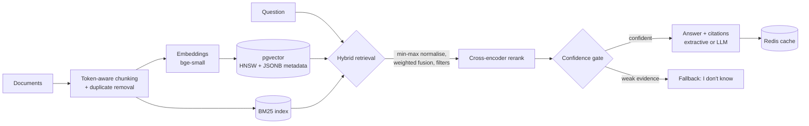

# Enterprise RAG & Hybrid Search Platform

[](https://github.com/LakheraSumer/Enterprise-RAG-Hybrid-Search-Platform/actions/workflows/ci.yml)

A retrieval-augmented generation (RAG) service that answers questions from your documents **with source citations**.
It combines **semantic vector search** and **BM25 keyword search**, reranks with a **cross-encoder**, refuses to
answer when the evidence is weak, and is benchmarked on a public information-retrieval dataset.

**Stack:** Python, FastAPI, PostgreSQL + pgvector, Redis, Docker, ONNX models via fastembed
(`BAAI/bge-small-en-v1.5` embeddings, `ms-marco-MiniLM-L-6-v2` cross-encoder), GitHub Actions.



## Results

Benchmarked on **BEIR SciFact** (5,183 scientific abstracts -> 7,610 chunks, 300 test queries with human relevance
labels), CPU only. Full report: [`results/EVAL.md`](results/EVAL.md).

| Configuration | P@5 | Recall@10 | MRR@10 | nDCG@10 | p50 latency |
|---|---|---|---|---|---|
| BM25 (keyword) | 0.152 | 0.763 | 0.600 | 0.635 | 3.7 ms |
| Dense (bge-small vectors) | 0.173 | 0.840 | 0.684 | 0.718 | 8.6 ms |
| **Hybrid (BM25 + vectors)** | 0.169 | **0.850** | **0.685** | **0.721** | 12.9 ms |
| Hybrid + cross-encoder rerank | 0.165 | 0.842 | 0.666 | 0.703 | 1,744 ms |

What this shows:

- **Hybrid retrieval wins:** +13.6% nDCG@10 and +8.7 points Recall@10 over keyword search, and slightly ahead of
  pure vector search, at ~13 ms per query.
- **Reranking is not free:** the general-domain MS MARCO cross-encoder did *not* help on scientific claims and added
  ~1.7 s per query on CPU, so it is off by default and kept as an option (it tends to help on web/FAQ-style text).
- **Answers stay grounded:** on 100 questions, 100% of extractive answer sentences come from retrieved sources, 70% of
  answers cite a document labelled relevant, and 7 low-evidence questions got the "not enough information" fallback.

## Features

- **Ingestion:** sentence-aware chunking under a token budget with overlap; exact-duplicate chunks are skipped;
  re-ingesting a document id replaces its old chunks (idempotent). Indexing runs as an async background job
  (`POST /documents` → `GET /jobs/{id}`).
- **Hybrid retrieval:** dense cosine search (pgvector HNSW index, or in-memory NumPy) + BM25, each min-max normalised and
  fused with a configurable weight; metadata filters (`{"department": "governance"}`) apply to both.
- **Reranking:** top candidates are re-scored by a cross-encoder that reads the query and passage together.
- **Grounded answers:** answers cite the passages they come from (`[1]`, `[2]`). Without an API key, the answer is
  extracted from the best-matching sentences; with any OpenAI-compatible LLM, the model is told to answer only from
  the numbered context. Questions without strong evidence get an explicit "not enough information" answer.
- **Resilience:** LLM calls use timeouts and retries with exponential backoff + jitter on 429/5xx, then fall back
  to the extractive answer; a Redis outage never fails a query (it just skips the cache).
- **Observability:** every response reports latency, confidence, retrieval scores per source, and token usage/cost.

## Quick start

```bash
python -m venv .venv && .venv/Scripts/activate      # Windows (use source .venv/bin/activate on macOS/Linux)
pip install -r requirements.txt -r requirements-dev.txt
python scripts/demo.py                               # indexes the sample knowledge base and answers 4 questions
uvicorn app.main:app --reload                        # API docs at http://localhost:8000/docs
```

Full stack (API + PostgreSQL/pgvector + Redis):

```bash
docker compose up --build
```

### API

```bash
curl -X POST localhost:8000/documents -H "Content-Type: application/json" \
  -d '{"documents":[{"id":"policy-1","title":"Retention policy","text":"Bronze data is kept for 400 days.","metadata":{"department":"governance"}}]}'

curl -X POST localhost:8000/query -H "Content-Type: application/json" \
  -d '{"question":"How long is bronze data kept?","filters":{"department":"governance"}}'
```

| Endpoint | Purpose |
|---|---|
| `POST /documents` | queue documents for indexing (returns a job id, HTTP 202) |
| `GET /jobs/{id}` | indexing job status and counts |
| `POST /search` | ranked chunks with dense, BM25 and rerank scores (`mode`: hybrid / dense / sparse) |
| `POST /query` | grounded answer, citations, confidence, sources, latency, token usage |
| `GET /health` | store, embedder, reranker, generator and cache in use |

## Configuration

All settings are environment variables - see [`.env.example`](.env.example). Without `DATABASE_URL` / `REDIS_URL`
the service uses in-memory stores; with `EMBEDDING_PROVIDER=hashing` it needs no model download (used by the tests).

## Evaluation

```bash
pip install -r requirements-eval.txt
python eval/evaluate.py
```

Downloads BEIR SciFact (5,183 abstracts, 300 test queries with human relevance labels) and compares BM25, dense,
hybrid and hybrid + rerank on P@5, Recall@10, MRR@10 and nDCG@10, plus answer groundedness and citation hit rate.
Results are written to [`results/EVAL.md`](results/EVAL.md).

## Tests

`pytest` runs 27 tests: chunking limits and overlap, BM25 and hybrid ranking, metadata filters, de-duplication,
idempotent re-ingestion, caching, confidence fallback, retry/backoff, LLM citation parsing and cost (mocked HTTP), LLM
outage fallback, the full HTTP API, and integration tests against real PostgreSQL/pgvector and Redis (run in CI with
service containers).

## Project layout

```
app/
  main.py          FastAPI app (async indexing jobs, search, query, health)
  pipeline.py      ingest -> chunk -> dedupe -> embed -> index; query -> retrieve -> confidence gate -> answer
  chunking.py      token-aware sentence chunking with overlap
  embeddings.py    bge-small (fastembed/ONNX) or offline hashing embedder
  bm25.py          incremental Okapi BM25
  vector_store.py  in-memory and PostgreSQL/pgvector stores
  retrieval.py     hybrid fusion, filters, de-duplication, reranking
  reranker.py      cross-encoder
  generation.py    extractive and LLM answers with citations
  cache.py  resilience.py  metrics.py  config.py  models.py
eval/evaluate.py   BEIR SciFact benchmark
data/sample/       small knowledge base for the demo and tests
tests/
```

## License

MIT
